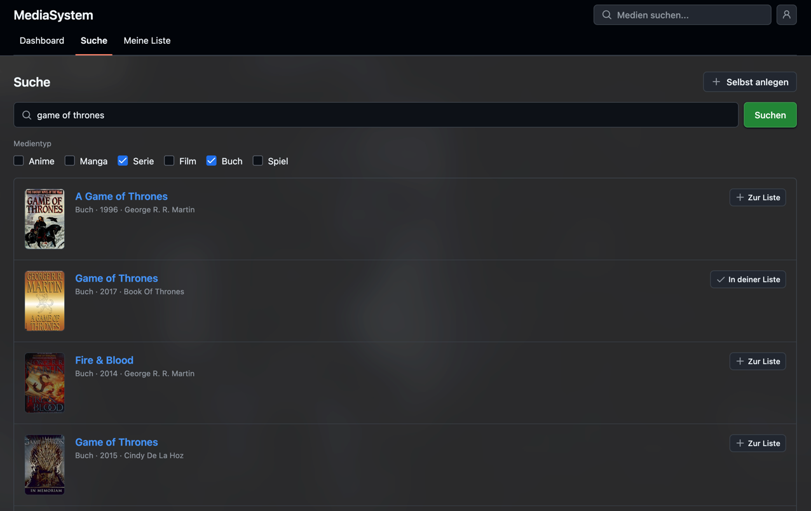
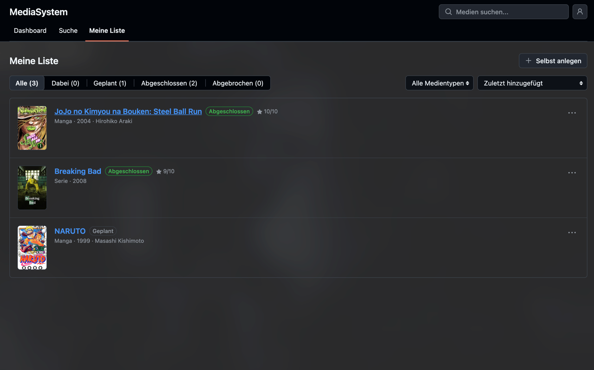
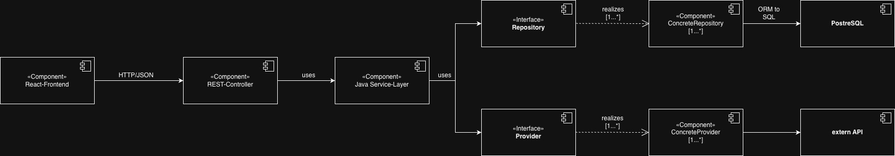

# MediaSystem

[](https://github.com/enessosa/MediaSystem/actions/workflows/backend-ci.yml)
[](https://github.com/enessosa/MediaSystem/actions/workflows/frontend-ci.yml)

A self-hosted web app for tracking media – anime, manga, series, movies, books and games. Search several external APIs at once, add what you find to your personal list and keep track of status, rating and notes.

This is primarily a **learning project**. The goal isn't just to ship a feature-complete app, but to practice the full lifecycle of a real system end to end:

- designing an architecture (layered, provider/repository interfaces, ADRs for the decisions that matter)
- building it properly (Java/Spring Boot backend, React/TypeScript frontend, Postgres, tested)
- running it in CI
- running and operating it myself (Docker, reverse proxy, HTTPS) – *in progress, see [Roadmap](#roadmap)*

It is meant to be run locally or privately for yourself and a few friends – there is no public instance.

| Search | My list |
|---|---|
|  |  |

## Features

- **Search across providers** – AniList (anime, manga), TMDB (series, movies), RAWG (games) and OpenLibrary (books), optionally filtered by media type. Results already on your list are marked as such.
- **Personal list** – status (planned / in progress / completed / dropped), rating 1–10 and notes per entry; filter by status and type, sort by date or rating.
- **Detail pages** for search results and your own entries, plus manually created entries for things no provider knows.
- **Accounts** – registration, login via server-side session, change password, delete account (including your whole list).
- **Signup cap** – the first 10 users can register freely; after that an invite codeword is required, if the admin has set one.
- **Admin** – the first registered user becomes admin and can view, change or remove the codeword in the account settings.

## Tech Stack

| Area | Technology |
|---|---|
| Backend | Java 25, Spring Boot 4, Maven |
| Frontend | React 19, TypeScript, Vite, [Primer React](https://primer.style/react) (GitHub's design system), React Router |
| Database | Postgres 17, Flyway migrations |
| Auth | Spring Security, server-side sessions with CSRF protection (JWT planned) |
| External APIs | AniList, TMDB, RAWG, OpenLibrary |
| CI | GitHub Actions (backend: build + tests, frontend: lint + build) |

## Getting Started

### Prerequisites

- Java 25
- Node.js 22+
- Docker (for Postgres)

### 1. API keys

AniList and OpenLibrary work without a key. For the other two, create free accounts:

| Provider | Media | Where to get the key |
|---|---|---|
| TMDB | series, movies | [themoviedb.org/settings/api](https://www.themoviedb.org/settings/api) – use the **API Read Access Token**, not the short API key |
| RAWG | games | [rawg.io/apidocs](https://rawg.io/apidocs) |

```bash
cp .env.example .env
# then put your keys into .env
```

A missing key is fine: that provider is skipped and its media types show up as disabled in the search.

### 2. Database

```bash
docker compose up -d postgres
```

### 3. Backend

```bash
cd backend
set -a && source ../.env && set +a   # load the API keys into the environment
./mvnw spring-boot:run
```

The API runs on `http://localhost:8080`. Flyway creates the schema on first start.

### 4. Frontend

```bash
cd frontend
npm ci
npm run dev
```

Open `http://localhost:5173`. The backend only accepts requests from this origin (CORS), so keep the default port.

### 5. First login

**Register right after the first start – the first account becomes admin.** Everyone after that is a regular user. As admin you can set an invite codeword under *Account*; it is only asked for from the 11th user on, and as long as no codeword is set, registration stays open.

### Running the checks

```bash
cd backend && ./mvnw verify          # tests
cd frontend && npm run lint && npm run build
```

## Project Structure

```
backend/         Spring Boot API (controllers, services, providers, JPA entities, Flyway migrations)
frontend/        React + TypeScript single-page app (pages, components, API client)
Documentation/   ADRs, UML/ER diagrams, screenshots
learn-progress/  short write-ups of concepts I learned along the way
```

## Architecture



External API integrations sit behind a `Provider` interface, so the service layer never depends on a specific provider and adding or removing an API only touches the implementation layer – see [ADR-002](Documentation/ADRs/ADR-002.md).

Architecture decisions are recorded as ADRs in [`Documentation/ADRs`](Documentation/ADRs):

- [ADR-001](Documentation/ADRs/ADR-001.md) – CI pipeline from day one
- [ADR-002](Documentation/ADRs/ADR-002.md) – layered architecture with provider/repository interfaces
- [ADR-003](Documentation/ADRs/ADR-003.md) – Postgres
- [ADR-004](Documentation/ADRs/ADR-004.md) – Flyway for migrations
- [ADR-005](Documentation/ADRs/ADR-005.md) – sessions first, JWT later
- [ADR-006](Documentation/ADRs/ADR-006.md) – Primer React as UI component library
- [ADR-007](Documentation/ADRs/ADR-007.md) – no public hosting, local/private deployment only
- [ADR-008](Documentation/ADRs/ADR-008.md) – open registration without codeword, first user becomes admin

## Planning & Design

Before writing any code, I deliberately spent time designing the system: modeling the domain, mapping out workflows, and thinking through the architecture and deployment up front rather than figuring it out along the way. That planning is captured in the following diagrams (in [`Documentation/Diagrams`](Documentation/Diagrams)):

> These diagrams reflect the planning phase. Some details have changed since (e.g. the admin role, games via RAWG, account management), so the code is the source of truth where they differ.

- [Use Case Diagram](Documentation/Diagrams/UML-UseCase-Diagram/UML-UseCase-Diagram.jpg)
- [Component Diagram](Documentation/Diagrams/UML-Component-Diagram/UML-Component-Diagram.jpg)
- [Class Diagram](Documentation/Diagrams/UML-Class-Diagram/Class-Diagram.jpg)
- [Package Diagram](Documentation/Diagrams/UML-Package-Diagram/Package-Diagram.jpg)
- [Sequence Diagram](Documentation/Diagrams/UML-Sequence-Diagram/UML-Sequence-Diagram.jpg)
- [Deployment Diagram](Documentation/Diagrams/UML-Deployment-Diagram/UML-Deployment-Diagram.jpg)
- [ER Diagram](Documentation/Diagrams/ER-Diagram/ER-Diagram.jpg)
- [Activity Diagram – Registration](Documentation/Diagrams/UML-Activity-Diagram/Activity-Diagram-Registration.jpg)
- [Activity Diagram – Search Media](<Documentation/Diagrams/UML-Activity-Diagram/Activity Diagram - Search Media.jpg>)
- [Activity Diagram – Add Media](<Documentation/Diagrams/UML-Activity-Diagram/Activity Diagram - Add Media.jpg>)

## Roadmap

- [x] Backend core: providers, list management, auth with server-side sessions
- [x] Frontend
- [ ] Rebuild auth on JWT (refresh tokens, revocation) – [ADR-005](Documentation/ADRs/ADR-005.md)
- [ ] Docker images for backend and frontend, reverse proxy + HTTPS for private hosting

## Use of AI

How AI tools were used in this project is documented in [Documented Use of AI](<Documentation/Documented Use of AI.md>).

## License

[MIT](LICENSE) © 2026 Enes Sadi
