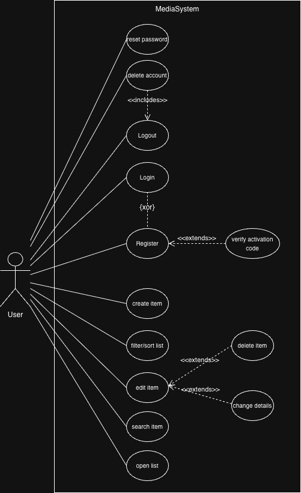
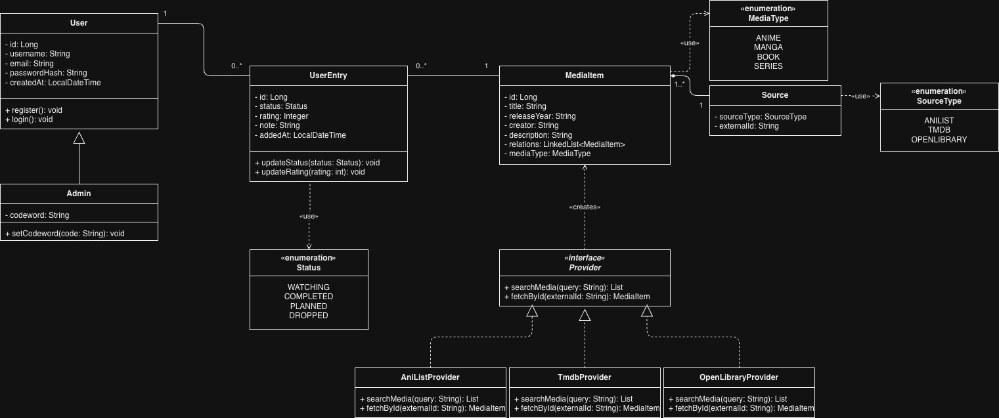
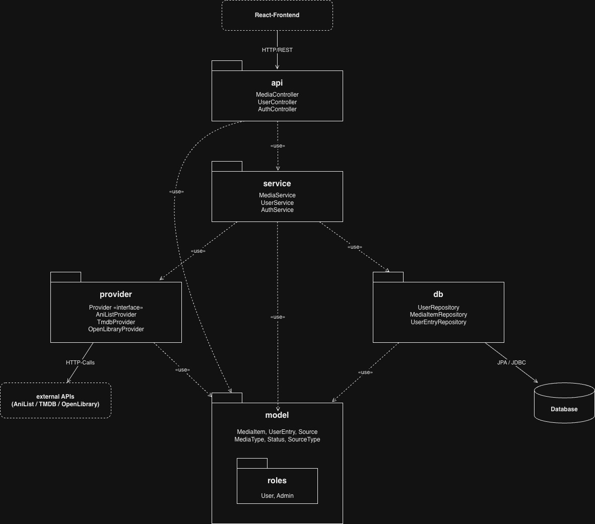
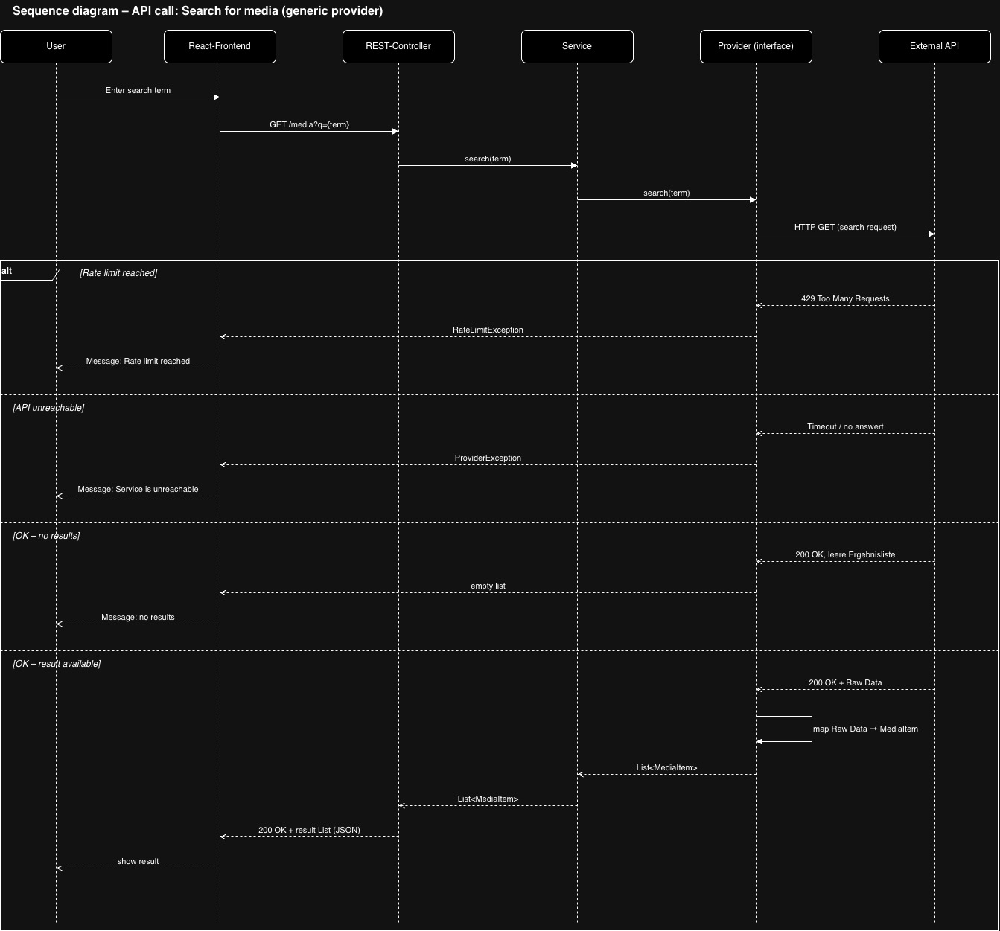
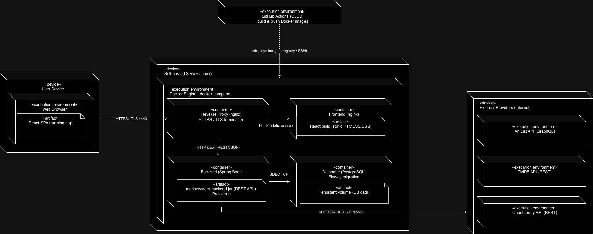
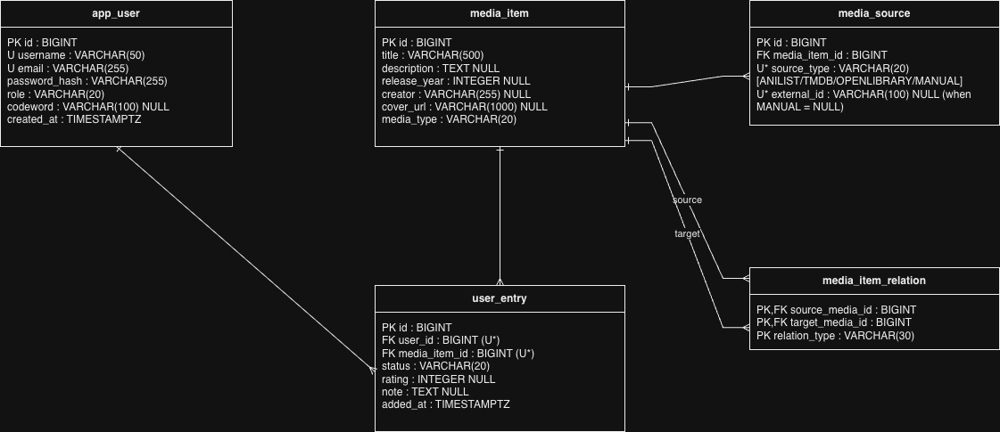
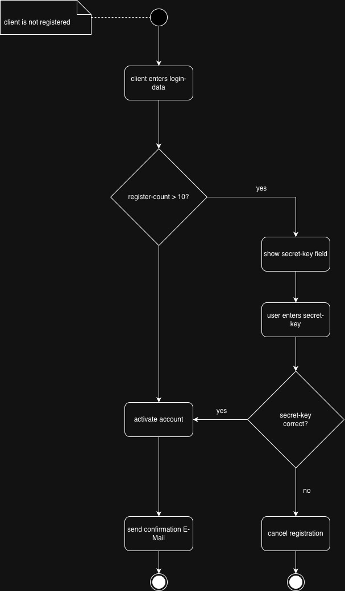

# MediaSystem

[](https://github.com/enessosa/MediaSystem/actions/workflows/backend-ci.yml)
[](https://github.com/enessosa/MediaSystem/actions/workflows/frontend-ci.yml)

A self-hosted web app for tracking media – anime, manga, series, movies, books and games. Search several external APIs at once, add what you find to your personal list and keep track of status, rating and notes.

This is primarily a **learning project**. The goal isn't just to ship a feature-complete app, but to practice the full lifecycle of a real system end to end:

- designing an architecture (layered, provider/repository interfaces, ADRs for the decisions that matter)
- building it properly (Java/Spring Boot backend, React/TypeScript frontend, Postgres, tested)
- running it in CI
- running and operating it myself (Docker, nginx as reverse proxy; HTTPS still open, see [Roadmap](#roadmap))

It is meant to be run locally or privately for yourself and a few friends – there is no public instance.

| Search | My list |
|---|---|
|  |  |

## Features

- **Search across providers** – AniList (anime, manga), TMDB (series, movies), RAWG (games) and OpenLibrary (books), optionally filtered by media type. Results already on your list are marked as such.
- **Personal list** – status (planned / in progress / completed / dropped), rating 1–10 and notes per entry; filter by status and type, sort by date or rating.
- **Detail pages** for search results and your own entries, plus manually created entries for things no provider knows.
- **Accounts** – registration, login via server-side session, change password, delete account (including your whole list).
- **Signup cap** – the first 10 users can register freely; after that an invite codeword is required, if the admin has set one.
- **Admin** – the first registered user becomes admin and can view, change or remove the codeword in the account settings.

## Tech Stack

| Area | Technology |
|---|---|
| Backend | Java 25, Spring Boot 4, Maven |
| Frontend | React 19, TypeScript, Vite, [Primer React](https://primer.style/react) (GitHub's design system), React Router |
| Database | Postgres 17, Flyway migrations |
| Auth | Spring Security, server-side sessions with CSRF protection (JWT planned) |
| External APIs | AniList, TMDB, RAWG, OpenLibrary |
| CI | GitHub Actions (backend: build + tests, frontend: lint + build) |
| Deployment | Docker, Docker Compose, nginx as reverse proxy |

## Getting Started

### Quick start with Docker

Clone the repository and build everything locally. The only prerequisite is [Docker](https://www.docker.com/) (Docker Desktop on macOS/Windows). To run it on a server or NAS without the source code, see [Deploy on a server or NAS](#deploy-on-a-server-or-nas).

**1. API keys.** AniList and OpenLibrary work without a key. For the other two, create free accounts:

| Provider | Media | Where to get the key |
|---|---|---|
| TMDB | series, movies | [themoviedb.org/settings/api](https://www.themoviedb.org/settings/api): use the **API Read Access Token**, not the short API key |
| RAWG | games | [rawg.io/apidocs](https://rawg.io/apidocs) |

```bash
cp .env.example .env
# then put your keys into .env
```

A missing key is fine: that provider is skipped and its media types show up as disabled in the search.

**2. Start everything.**

```bash
docker compose up -d --build
```

This builds the backend and frontend images and starts three containers: Postgres, the Spring Boot backend and nginx, which serves the frontend and forwards `/api/` to the backend ([ADR-009](Documentation/ADRs/ADR-009.md)). Open `http://localhost:8580`. The first build takes a few minutes; Flyway creates the database schema on first start.

**3. First login.** Register right after the first start: **the first account becomes admin.** Everyone after that is a regular user. As admin you can set an invite codeword under *Account*; it is only asked for from the 11th user on, and as long as no codeword is set, registration stays open.

Useful commands:

```bash
docker compose logs -f backend   # follow the backend logs
docker compose up -d             # apply changes to .env
docker compose down              # stop everything (data stays in the postgres_data volume)
```

The port can be changed with `APP_PORT` in `.env` (default `8580`); `POSTGRES_PORT` does the same for the database, which is only reachable from your own machine.

### Deploy on a server or NAS

For running MediaSystem permanently, e.g. on a NAS, you don't need the source code. Every release is published as prebuilt images on the GitHub Container Registry ([ADR-010](Documentation/ADRs/ADR-010.md)), so the machine only needs two files. Prerequisites: Docker with Docker Compose 2.24 or newer (`docker compose version`); the images are built for `amd64` (Intel/AMD).

**1. Get the files.** Connect via SSH and create a folder, e.g. in the shared folder your NAS uses for Docker:

```bash
mkdir -p /volume1/docker/mediasystem && cd /volume1/docker/mediasystem
curl -L -o docker-compose.prod.yml https://raw.githubusercontent.com/enessosa/MediaSystem/main/docker-compose.prod.yml
curl -L -o .env https://raw.githubusercontent.com/enessosa/MediaSystem/main/.env.example
```

On many NAS systems, Docker commands need `sudo`.

**2. Edit `.env`** (e.g. with `nano .env`): add your API keys and set your own database password:

```
POSTGRES_PASSWORD=a-long-random-password
```

Do this **before the first start**. Postgres only reads the password once, when it creates the database; changing it later locks the backend out.

**3. Start.**

```bash
docker compose -f docker-compose.prod.yml up -d
```

Docker downloads the images, nothing is built. Open `http://<server-ip>:8580` and register right away, since the first account becomes admin.

**Updates.** After a new release:

```bash
docker compose -f docker-compose.prod.yml pull
docker compose -f docker-compose.prod.yml up -d
```

The containers use the `latest` images by default, so a NAS UI that shows containers as "updatable" picks up new releases as well; always update backend and frontend together. Database migrations run automatically on start. To stay on a specific release, set `MEDIASYSTEM_VERSION=0.2.0` in `.env`.

**Backups.** All data lives in the `postgres_data` volume. To create a dump:

```bash
docker compose -f docker-compose.prod.yml exec postgres pg_dump -U mediasystem mediasystem > backup.sql
```

**Access from outside your home network:** use a VPN (e.g. Tailscale or the VPN of your router/NAS). Don't forward the port in your router: the app runs without HTTPS and is not meant to be public ([ADR-007](Documentation/ADRs/ADR-007.md)).

### Development setup

For working on the code, run backend and frontend directly, with hot reload. Prerequisites: Java 25, Node.js 22+ and Docker (for Postgres). Create the `.env` as described above.

```bash
# 1. Database (only reachable from your own machine)
docker compose up -d postgres

# 2. Backend on http://localhost:8080
cd backend
set -a && source ../.env && set +a   # load the API keys into the environment
./mvnw spring-boot:run

# 3. Frontend on http://localhost:5173 (in a second terminal)
cd frontend
npm ci
npm run dev
```

Open `http://localhost:5173`. In this setup the frontend talks to the backend directly, and the backend only accepts requests from this origin (CORS), so keep the default port.

### Running the checks

```bash
cd backend && ./mvnw verify          # tests (need the Postgres container)
cd frontend && npm run lint && npm run build
```

## Project Structure

```
backend/         Spring Boot API (controllers, services, providers, JPA entities, Flyway migrations)
frontend/        React + TypeScript single-page app (pages, components, API client)
Documentation/   ADRs, UML/ER diagrams, screenshots
learn-progress/  short write-ups of concepts I learned along the way
```

## Architecture


External API integrations sit behind a `Provider` interface, so the service layer never depends on a specific provider and adding or removing an API only touches the implementation layer – see [ADR-002](Documentation/ADRs/ADR-002.md).

Architecture decisions are recorded as ADRs in [`Documentation/ADRs`](Documentation/ADRs):

- [ADR-001](Documentation/ADRs/ADR-001.md) – CI pipeline from day one
- [ADR-002](Documentation/ADRs/ADR-002.md) – layered architecture with provider/repository interfaces
- [ADR-003](Documentation/ADRs/ADR-003.md) – Postgres
- [ADR-004](Documentation/ADRs/ADR-004.md) – Flyway for migrations
- [ADR-005](Documentation/ADRs/ADR-005.md) – sessions first, JWT later
- [ADR-006](Documentation/ADRs/ADR-006.md) – Primer React as UI component library
- [ADR-007](Documentation/ADRs/ADR-007.md) – no public hosting, local/private deployment only
- [ADR-008](Documentation/ADRs/ADR-008.md) – open registration without codeword, first user becomes admin
- [ADR-009](Documentation/ADRs/ADR-009.md) – nginx as reverse proxy, frontend and API on one origin
- [ADR-010](Documentation/ADRs/ADR-010.md) – prebuilt images via GitHub Container Registry
- [ADR-011](Documentation/ADRs/ADR-011.md) – accounts without email address

## Planning & Design

Before writing any code, I deliberately spent time designing the system: modeling the domain, mapping out workflows, and thinking through the architecture and deployment up front rather than figuring it out along the way. That planning is captured in the following diagrams (in [`Documentation/Diagrams`](Documentation/Diagrams)):

> These diagrams reflect the planning phase. Some details have changed since (e.g. the admin role, games via RAWG, account management), so the code is the source of truth where they differ.

<table>
  <tr>
    <td align="center"><a href="Documentation/Diagrams/UML-UseCase-Diagram/UML-UseCase-Diagram.jpg"></a><br>Use Case</td>
    <td align="center"><a href="Documentation/Diagrams/UML-Component-Diagram/UML-Component-Diagram.jpg"></a><br>Component</td>
    <td align="center"><a href="Documentation/Diagrams/UML-Class-Diagram/Class-Diagram.jpg"></a><br>Class</td>
  </tr>
  <tr>
    <td align="center"><a href="Documentation/Diagrams/UML-Package-Diagram/Package-Diagram.jpg"></a><br>Package</td>
    <td align="center"><a href="Documentation/Diagrams/UML-Sequence-Diagram/UML-Sequence-Diagram.jpg"></a><br>Sequence</td>
    <td align="center"><a href="Documentation/Diagrams/UML-Deployment-Diagram/UML-Deployment-Diagram.jpg"></a><br>Deployment</td>
  </tr>
  <tr>
    <td align="center"><a href="Documentation/Diagrams/ER-Diagram/ER-Diagram.jpg"></a><br>ER</td>
    <td align="center"><a href="Documentation/Diagrams/UML-Activity-Diagram/Activity-Diagram-Registration.jpg"></a><br>Activity – Registration</td>
    <td align="center"><a href="Documentation/Diagrams/UML-Activity-Diagram/Activity%20Diagram%20-%20Search%20Media.jpg"></a><br>Activity – Search Media</td>
  </tr>
  <tr>
    <td align="center"><a href="Documentation/Diagrams/UML-Activity-Diagram/Activity%20Diagram%20-%20Add%20Media.jpg"></a><br>Activity – Add Media</td>
    <td></td>
    <td></td>
  </tr>
</table>

Click a diagram to open it in full size.

## What I Learned

### Technical

- **Spring Security beyond the defaults:** server-side sessions, how a session cookie turns back into an `Authentication` on every request, cookie-based CSRF protection for a single-page app, CORS with credentials, and role-based authorization with a second layer (`@PreAuthorize`) as defense in depth.
- **JPA/Hibernate pitfalls:** lazy loading and `LazyInitializationException`, why service methods need `@Transactional`, single-table inheritance (`Admin extends User`), and why entities should never be returned directly (DTOs instead of leaking `passwordHash`).
- **Designing for change:** the provider pattern behind an interface made adding a fourth external API (RAWG) a matter of one new class, without touching the service layer.
- **Working with external APIs:** four different auth styles (Bearer header, query key, GraphQL, none), mapping inconsistent responses onto one domain model, and handling failures like a missing key or a provider that is down.
- **Schema migrations** with Flyway instead of letting Hibernate generate the database.
- **React and TypeScript from zero:** components, state, hooks, context, routing, and connecting a frontend to a real backend.
- **Testing:** unit tests with Mockito (including surprises like mocks not running an interface's `default` methods), security tests with MockMvc, and a CI pipeline that runs them on every push.

### Beyond the code

- **A project is iterative, no matter how much you plan.** I planned a lot up front (use cases, diagrams, ADRs) and it was worth it, but the result still looks different from the plan. Requirements changed, a first frontend was thrown away, and decisions like the signup rule were revised once I actually used the app.
- **Writing decisions down pays off.** ADRs force you to name the alternatives and the trade-offs. When a decision is revisited later, you know why it was made in the first place.
- **Every decision has a price, and sometimes you only see it later.** I chose to let the whole search fail if one provider fails, so the user never gets an incomplete result. When AniList went down because of the php exploit, the cost of that became very concrete.
- **Building something and running it are two different things.** Hosting publicly would have meant an imprint, GDPR obligations for other people's data, backups and updates. Deciding against it was a real decision, not giving up.
- **Scope is something you have to manage actively.** There is always one more feature or edge case; knowing what is good enough for now is part of the work.
- **AI is a tool, not a replacement for understanding.** I used Claude to explain concepts and to write parts of the code. It made me faster, but only where I understood what it produced. The parts I wrote myself are the parts I learned the most from.

## Roadmap

- [x] Backend core: providers, list management, auth with server-side sessions
- [x] Frontend
- [ ] Rebuild auth on JWT (refresh tokens, revocation) – [ADR-005](Documentation/ADRs/ADR-005.md)
- [x] Docker images for backend and frontend, nginx as reverse proxy, one `docker compose up` for everything
- [ ] HTTPS for running it on a private server

## Use of AI

How AI tools were used in this project is documented in [Documented Use of AI](<Documentation/Documented Use of AI.md>).

## License

[MIT](LICENSE) © 2026 Enes Sadi
